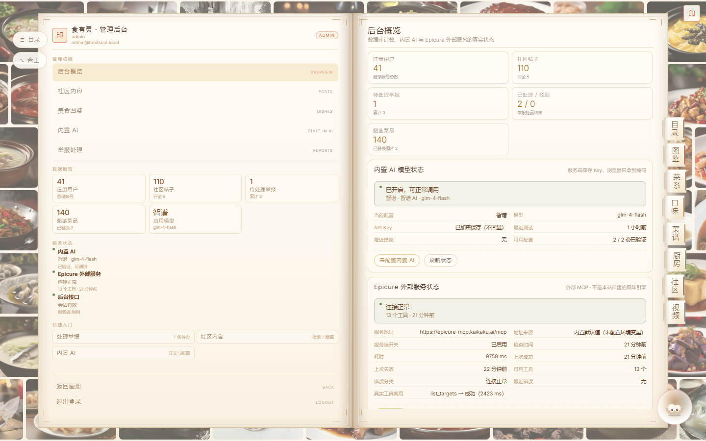
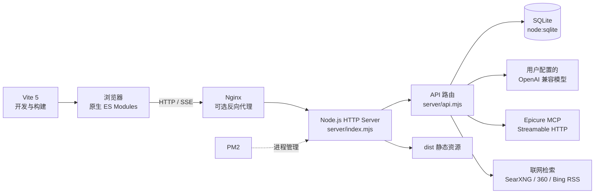

# 食有灵 · FOOD SOUL

> 一个以中国美食文化为主题，融合画册式交互、AI 美食对话、Epicure 风味分析、AI 创意厨房、智能菜谱和个性化推荐能力的沉浸式数字美食画册。

[GitHub 仓库](https://github.com/xuxi666/food-soul) · [线上演示](http://47.93.33.108/) · [部署说明](docs/DEPLOY.md) · [后台模块记录](docs/ADMIN-BACKEND.md)

## 1. 项目简介

食有灵不是普通的菜谱查询网站。它把整个站点做成一本可翻阅的中国美食画册：

- 封面翻开后进入序言、目录和章节；
- 主内容使用左右双页、纸张层、书脊、章节书签和翻页动画；
- 菜品、菜系、味型都有可对话的 AI 人格；
- 厨房用 Epicure MCP 做食材关系分析和 AI 配方设计；
- 菜谱、推荐和社区内容都尽量标注真实来源，不把演示数据伪装成真实结果。

站点的 AI 模型由用户在「接入 AI」中自行配置为任意 OpenAI 兼容接口。**仓库不内置模型 API Key**；服务端只保存经 AES-256-GCM 加密后的用户 Key。

## 2. 已实现功能

### 2.1 画册式交互

- 数字画册封面、序言、目录；
- 左右双页与单页响应式布局；
- 章节书签、页码、翻页叶片；
- 开书、合书、翻页和圆形转场动画；
- 桌面、平板、手机视口适配。

### 2.2 美食图鉴

- 菜品浏览、搜索和分类筛选；
- 八大菜系与八种味型两条探索线；
- 菜品详情、食材与风味信息；
- 菜品图片覆盖与真实数据回读。

### 2.3 AI 美食对话

- 每个菜品、菜系、味型有独立人格提示词；
- SSE 流式输出，多轮上下文；
- 回答后可生成 1–3 条可点击的延伸问题；
- 支持复制回答、重新生成等交互。

### 2.4 Epicure AI 厨房

- 食材库与食材搜索；
- 食材风味图谱和关系分析；
- 外部 Epicure MCP 的配方设计能力；
- 菜谱营养信息（由本地营养数据服务计算，来源会在界面标注）；
- Epicure 不可用时明确降级，不伪造风味结果。

### 2.5 AI 寻味推荐

- 按心情、口味、预算、用餐场景和补充需求生成推荐；
- AI 独立构思菜品，而不是只从固定菜谱中挑选；
- 支持候选来源合并、预算单选和配图；
- 推荐失败时给出明确错误，不展示假数据。

### 2.6 智能菜谱

- 菜名查询、图鉴优先匹配；
- 图鉴没有时执行真实联网检索并展示来源；
- 结构化菜谱生成，展示食材、步骤、份量和营养信息；
- 支持再生成、复制和分享到社区。

### 2.7 背景音乐与社区

- 全站背景音乐播放、暂停和会话内记忆；
- 邮箱注册 / 登录、HttpOnly Cookie 会话；
- 社区发帖、回复、点赞、举报、删除自己的内容；
- 社区图片上传和内容管理后台。

### 2.8 管理后台

访问 `/admin`。管理员由服务端 `ADMIN_EMAILS` 白名单决定，前端无法伪造角色。

- 真实数据库计数概览；
- 社区内容筛选、编辑、隐藏、恢复和删除；
- 菜品图片覆盖；
- 举报处理和审计记录；
- 内置 AI 多套配置、全站开关和连接测试；
- Epicure 服务状态真实探测。

详细台账与已知边界见 [docs/ADMIN-BACKEND.md](docs/ADMIN-BACKEND.md)。

## 3. 界面与演示资料



- 管理后台 PC / 平板 / 手机截图：[docs/admin-shots](docs/admin-shots/)
- 画册墙面交互演示视频：[docs/wall-demo.webm](docs/wall-demo.webm)
- 用例、时序、状态、活动和架构图：[docs/diagrams](docs/diagrams/)

## 4. 技术架构



### 技术栈

| 层 | 实际实现 |
|---|---|
| 前端 | Vite 5 + 原生 JavaScript ES Modules，无 React/Vue 框架 |
| 样式 | 原生 CSS、CSS 变量、媒体查询、3D transform 纸页效果 |
| 后端 | Node.js 原生 `http`，无 Express |
| 数据库 | Node 内置 `node:sqlite`，单文件 SQLite |
| 安全 | `node:crypto`：scrypt 密码哈希、AES-256-GCM Key 加密、HttpOnly Cookie |
| AI | OpenAI 兼容 `/chat/completions`，SSE 流式输出 |
| 外部风味服务 | Epicure MCP（Streamable HTTP + JSON-RPC），可关闭、可降级 |
| 联网检索 | 自建 SearXNG + 360 搜索 + Bing RSS，无付费检索 Key |
| 部署 | Vite 构建 + Node 静态服务 + Nginx/PM2（生产可选） |

## 5. 项目目录

```text
food-soul/
├── src/
│   ├── book/                画册外壳、章节、纸张、翻页、书签
│   ├── components/          音乐、评论、小精灵等通用组件
│   ├── data/                菜品、菜系、味型、人格和音乐数据
│   ├── lib/                 API、DOM、转场、剪贴板等工具
│   ├── views/               各章节页面（含后台 admin.js）
│   ├── styles/              主题和模块样式
│   └── main.js              应用入口
├── server/
│   ├── index.mjs            生产静态服务入口
│   ├── api.mjs              HTTP API 统一路由
│   ├── admin-routes.mjs     后台接口
│   ├── auth.mjs             会话与管理员权限
│   ├── db.mjs               SQLite 数据访问
│   ├── security.mjs         密码、会话、Key 加解密
│   ├── ai-adapter.mjs       OpenAI 兼容适配
│   ├── ai-config.mjs        用户级 AI 配置
│   ├── site-ai.mjs          全站内置 AI 配置
│   ├── epicure-client.mjs   Epicure MCP 客户端
│   ├── epicure-service.mjs  厨房风味编排
│   ├── web-search.mjs       联网检索
│   ├── recipe-lookup.mjs    菜名匹配与来源检索
│   ├── nutrition-*.mjs      营养数据与计算
│   └── community.mjs        社区、评论、举报
├── public/                  背景图、菜品图、音乐、字体等静态资源
├── data/                    Epicure 目录、营养库等可跟踪数据
├── docs/                    部署、后台、推荐、营养等专题文档
├── scripts/                 构建辅助、QA 验收和部署脚本
├── .env.example             环境变量模板（无真实密钥）
├── .gitignore
├── package.json
├── package-lock.json
├── vite.config.js
└── README.md
```

> `HANDOFF.md` 是本机内部交接记录，不属于公开交付物，已从 Git 跟踪中移除并加入 `.gitignore`；公开项目说明以 README 和 `docs/` 为准。

## 6. 本地运行

### 5.1 环境要求

- Node.js **≥ 22.5**（使用内置 `node:sqlite`）；本机验证版本为 Node `v24.21.0`。
- npm（随 Node 安装）。
- 操作系统：Windows、macOS、Linux 均可；本文命令以通用 shell 为主。
- 浏览器：建议最新版 Chrome、Edge、Firefox 或 Safari。
- 外部 AI、Epicure MCP、SearXNG 均为可选依赖；未配置时对应功能会明确提示或降级。

### 5.2 克隆与安装

```bash
git clone https://github.com/xuxi666/food-soul.git
cd food-soul
npm ci
```

仓库包含 `package-lock.json`，优先使用 `npm ci` 获得可复现安装；需要更新依赖时再使用 `npm install`。

### 5.3 配置环境变量

```bash
# macOS / Linux
cp .env.example .env

# Windows PowerShell
Copy-Item .env.example .env
```

至少生成一个 32 字节的 `AI_CONFIG_SECRET` 并写入 `.env`：

```bash
node --input-type=module -e "import c from 'node:crypto'; console.log(c.randomBytes(32).toString('base64'))"
```

其他变量按需填写，完整说明见第 8 节。**不要把真实 `.env` 提交到 Git。**

### 5.4 启动开发环境

```bash
npm run dev
```

打开 <http://127.0.0.1:5180>。Vite 会把 `/api/*` 请求交给 `server/api.mjs`，本地不需要单独启动后端。

首次使用：

1. 右上角「登录 / 注册」创建账号；
2. 点击「接入 AI」，填写服务商、Base URL、模型 ID 和 API Key；
3. 点击「测试连接」，真实请求成功后才能保存；
4. 保存后即可使用聊天、菜谱和推荐。

`AI_CONFIG_SECRET` 缺失时浏览和普通页面仍可打开，但保存 AI 配置会明确失败；这是有意的安全行为。

## 7. 生产构建与部署

```bash
npm run build       # 生成 dist/
npm start            # 静态托管 dist/ 和 /api，默认 127.0.0.1:5190
```

生产建议由 Nginx 反向代理到 `127.0.0.1:5190`，SSE 必须关闭代理缓冲：

```nginx
location / {
    proxy_pass http://127.0.0.1:5190;
    proxy_http_version 1.1;
    proxy_set_header Host $host;
    proxy_set_header X-Forwarded-For $proxy_add_x_forwarded_for;
    proxy_buffering off;
    proxy_read_timeout 300s;
    client_max_body_size 12m;
}
```

使用 PM2 的常见启动方式：

```bash
pm2 start npm --name food-soul -- start
pm2 status
pm2 logs food-soul
pm2 restart food-soul
```

当前项目还提供了 `npm run ship` 部署脚本：它从本机 `.deploy.env` 读取服务器信息，构建并重启远程 PM2，再由服务器同步 GitHub。该脚本需要自行配置 SSH 和服务器权限；不会把 `.deploy.env`、`.env`、数据库或上传文件带入仓库。详细步骤、故障排查和安全约定见 [docs/DEPLOY.md](docs/DEPLOY.md)。

## 8. 环境变量

下表以源码实际读取为准。`必填` 表示缺少后核心功能不可用；其余为可选或可降级配置。

| 变量 | 必填 | 默认值 | 说明 |
|---|---:|---|---|
| `AI_CONFIG_SECRET` | 是 | 无 | 32 字节 base64/hex，用于 AES-256-GCM 加密用户 API Key；丢失后旧 Key 无法解密 |
| `AI_CONFIG_SECRET_PREVIOUS` | 否 | 空 | 密钥轮换期间解密旧密文 |
| `AI_CONFIG_KEY_VERSION` | 否 | `1` | 当前密钥版本号 |
| `PORT` | 否 | `5190` | `npm start` 监听端口；只绑定 `127.0.0.1` |
| `NODE_ENV` | 否 | 空 | 设为 `production` 时 Cookie 强制 Secure；HTTPS 由 Nginx 终止 |
| `DB_PATH` | 否 | `data/foodsoul.db` | SQLite 数据库路径 |
| `SESSION_TTL_DAYS` | 否 | `7` | 登录会话有效期，服务端限制 1–30 天 |
| `ADMIN_EMAILS` | 否 | 空 | 管理员邮箱白名单，逗号分隔；登录后按白名单同步角色 |
| `SEARXNG_URL` | 否 | 空 | 自建 SearXNG 地址；未设置时跳过该来源，继续尝试 360 / Bing |
| `BING_RSS_URL` | 否 | `https://cn.bing.com/search` | Bing RSS 检索端点；空串可关闭 |
| `SO360_URL` | 否 | `https://www.so.com/s` | 360 搜索结果页端点；空串可关闭 |
| `EPICURE_ENABLED` | 否 | `true` | Epicure 总开关；`false` 时厨房相关功能整体降级 |
| `EPICURE_MCP_URL` | 否 | `https://epicure-mcp.kaikaku.ai/mcp` | Epicure MCP 端点 |
| `EPICURE_TIMEOUT_MS` | 否 | `10000` | 单次 MCP 调用超时 |
| `EPICURE_CACHE_TTL_MS` | 否 | `300000` | 工具列表缓存时间 |
| `EPICURE_MAX_CONCURRENCY` | 否 | `3` | Epicure 并发上限 |
| `EPICURE_CATALOG_URL` | 否 | Epicure 官方食材目录 | 食材目录同步地址 |

### 验证脚本专用变量

以下变量只供 `scripts/verify-*.mjs` 本地验收使用，不是服务端运行配置：

| 变量 | 说明 |
|---|---|
| `BASE` | 被测地址，默认 `http://127.0.0.1:5180` 或脚本内对应端口 |
| `ADMIN_EMAIL` | 本地测试管理员邮箱 |
| `ADMIN_PASS` | 本地测试管理员密码；必须由环境变量提供，仓库不记录 |

## 9. 依赖说明

### 生产依赖

- `@modelcontextprotocol/sdk`：Epicure MCP Streamable HTTP 客户端；
- `zod`：菜谱和请求结构校验。

### 开发依赖

- `vite`：开发服务器和生产前端构建；
- `playwright-core`：本地浏览器验收脚本，使用本机 Chrome。

### Node 内置能力

项目不依赖 Express、SQLite 原生扩展或 ORM：

- `node:http`：HTTP 服务；
- `node:sqlite`：数据库；
- `node:crypto`：密码哈希、会话令牌和 Key 加密。

### 外部系统

- 用户自己的 OpenAI 兼容 AI 服务；
- Epicure MCP（可关闭）；
- 可选自建 SearXNG；
- 生产可用 Nginx + PM2（非强制）。

## 10. 测试与验收

仓库目前**没有 unit test runner**，也没有把未执行的测试写成“全部通过”。现有可执行检查包括：

```bash
npm run build
node --check server/index.mjs
node scripts/verify-ai-config.mjs
node scripts/verify-admin.mjs
node scripts/verify-community-auth.mjs
node scripts/verify-epicure.mjs
```

`verify-*.mjs` 是会访问真实本地服务、数据库或外部服务的集成验收脚本，不等于单元测试；部分脚本还需要先启动 `npm run dev`、准备本地账号或配置模型。运行前请先阅读脚本顶部的前置条件。

### 本次交付的构建记录

- `npm run build`：通过（Vite 5.4.21，产物输出到 `dist/`）；
- `node --check`：对本次修改的脚本执行语法检查；
- 仓库不伪造测试数量、覆盖率或外部服务调用结果。

## 11. 安全说明

- `.env`、`.env.*`、`.deploy.env`、数据库、日志和上传文件均不进入仓库；根目录 `.env.example` 只包含占位值。
- 用户 AI Key 以 AES-256-GCM 密文存储，接口响应不回传明文 Key。
- 管理员权限只由服务端 `ADMIN_EMAILS` 决定，前端角色字段不可信。
- 生产环境建议使用 HTTPS、限制 SSH 来源、禁用密码登录并定期轮换部署密钥。
- 如发现安全问题，请通过 GitHub 仓库的 **Security → Report a vulnerability** 私密报告，不要在公开 Issue 中粘贴真实密钥。
- 公开文档不记录服务器 SSH 私钥、数据库密码或真实 API Key。

## 12. 团队信息

> 以下为需要项目负责人补充的真实信息占位，仓库不虚构成员、学校或联系方式。

| 项 | 内容 |
|---|---|
| 项目团队名称 | `<待填写>` |
| 项目负责人 | `<待填写>` |
| 团队成员 | `<待填写>` |
| 团队分工 | `<待填写：前端 / 后端 / AI / 设计 / 测试 / 文档>` |
| 学校 / 组织 | `<待填写>` |
| 联系方式 | `<待填写>` |

## 13. 已知限制

- 仅支持 OpenAI 兼容接口；Anthropic / Gemini 原生协议需要兼容网关。
- 配置了聊天模型不等于具备联网能力，联网检索走独立链路。
- SQLite 与内存限流适合单实例；多实例部署需要替换为共享数据库和共享限流。
- 未实现邮箱验证、找回密码和双因素登录。
- 管理后台只覆盖已有数据模型；没有待审核队列、用户管理、菜品增删改和独立审计页。
- Epicure 的 `analyze / pair / create` 目前主要通过服务端接口提供，后台只做状态探测。
- 背景音乐、外部 AI、Epicure 和 SearXNG 均依赖运行环境；外部服务不可用时会有降级或明确提示。

## 14. 许可证

仓库当前**没有添加 LICENSE 文件，也没有正式声明开源许可证**。在项目负责人确认许可证类型并添加 LICENSE 之前，请不要默认本项目采用 MIT 或其他许可证。若计划以 MIT、Apache-2.0 等方式开源，应由负责人确认后补充正式许可证文本。

## 15. 相关文档

- [部署与同步](docs/DEPLOY.md)
- [管理后台模块台账](docs/ADMIN-BACKEND.md)
- [推荐模块说明](docs/RECOMMENDATIONS.md)
- [营养数据说明](docs/NUTRITION.md)
- [社区双页说明](docs/COMMUNITY-DUAL-PAGE.md)
- [项目历史交接](docs/PROJECT-HANDOVER.md)