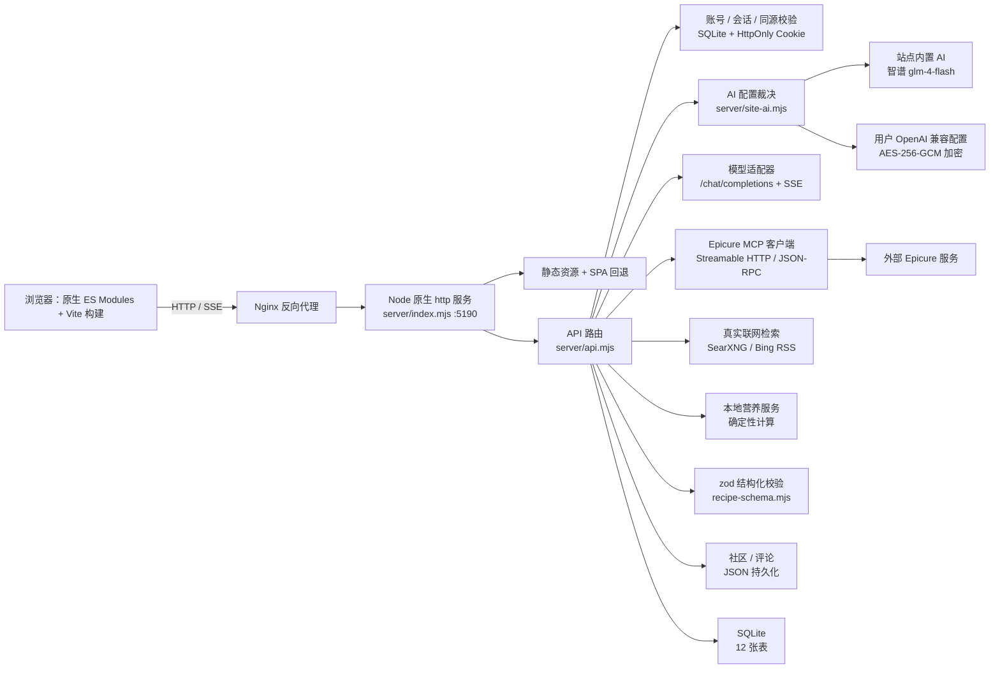
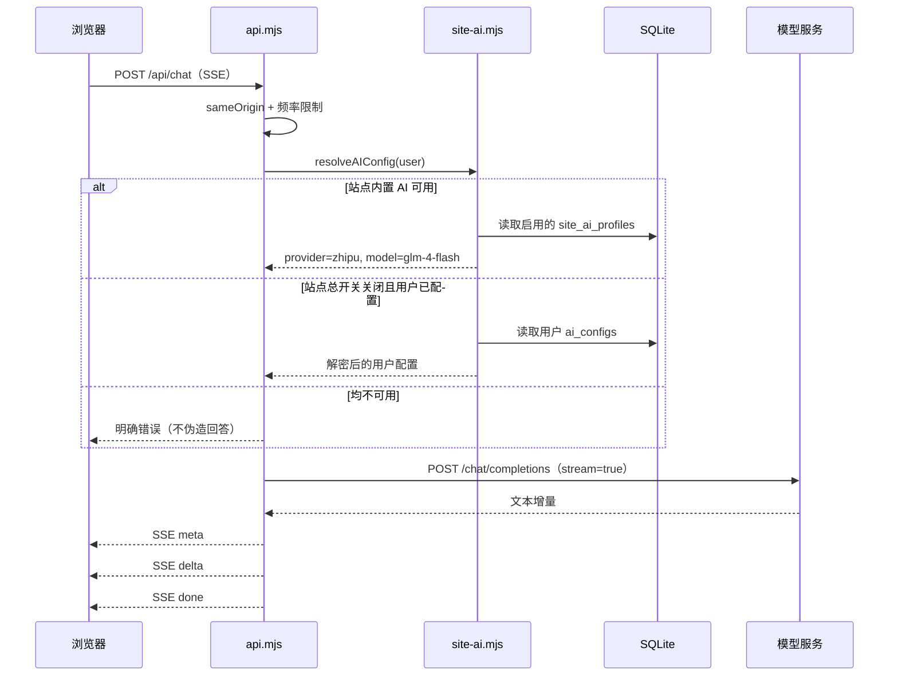
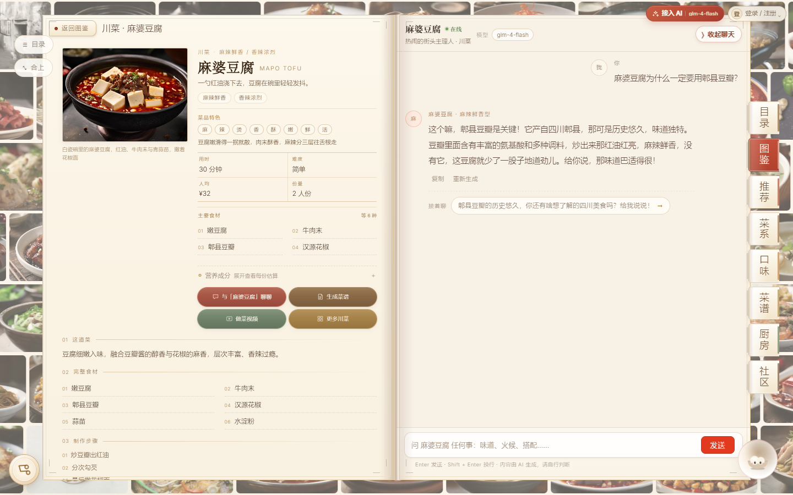
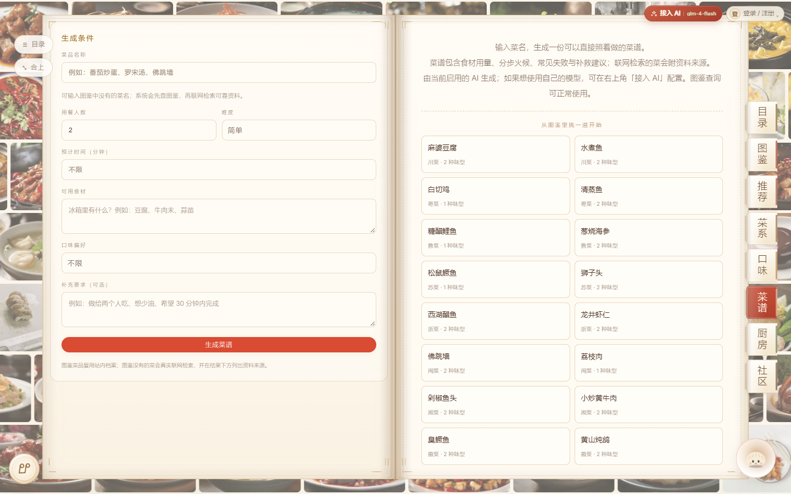
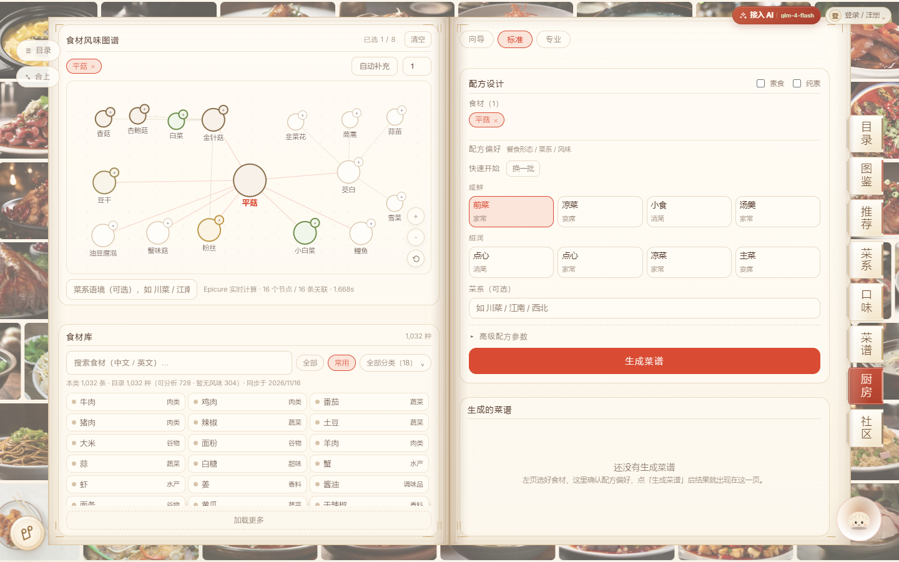
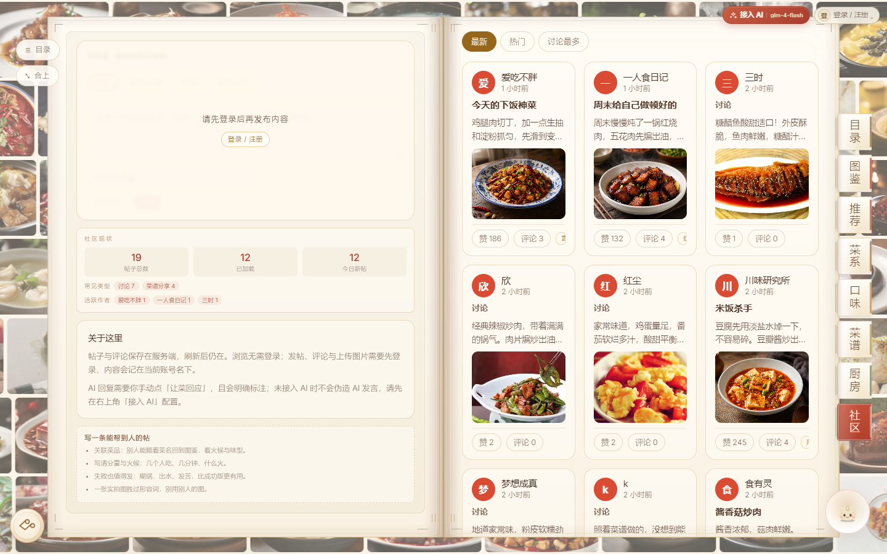
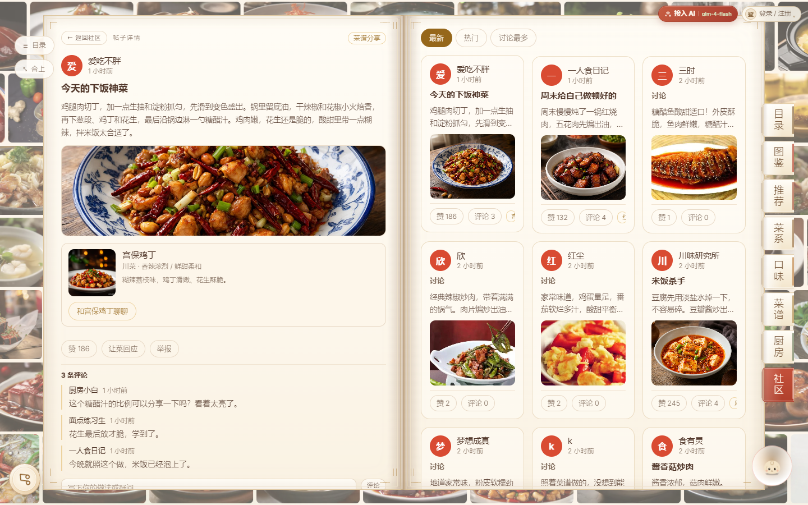
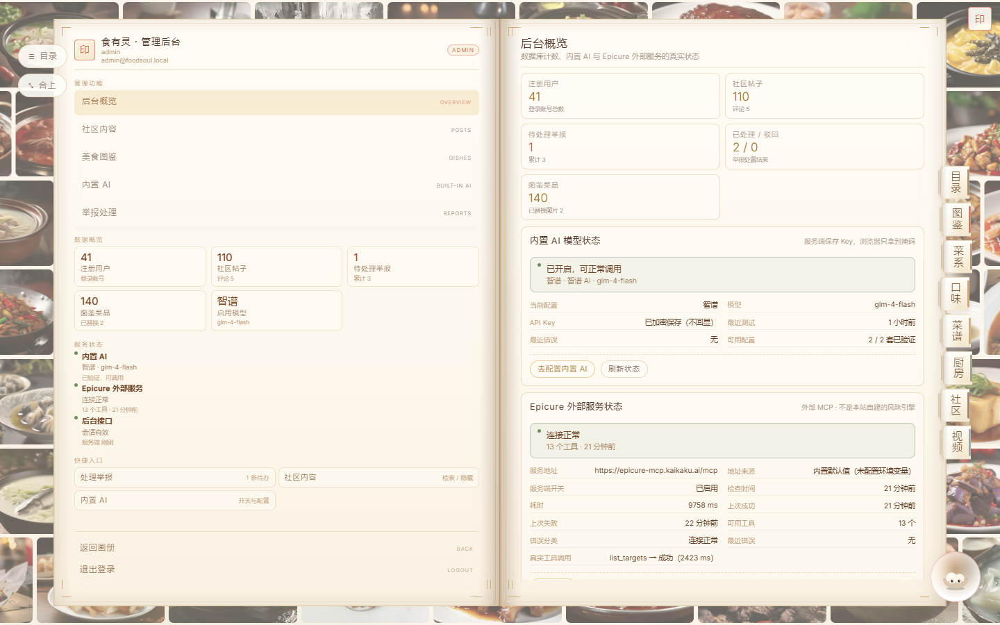

# 食有灵 FOOD SOUL 作品介绍文档

> 文档版本：2026-11-16  
> 项目名称：食有灵 · FOOD SOUL（代码包名 `food-soul`）  
> 代码仓库：[https://github.com/xuxi666/food-soul](https://github.com/xuxi666/food-soul)  
> 线上站点：[http://115.29.162.117/](http://115.29.162.117/)  
> 本文证据基线：本地仓库 `main` 分支提交 `49794e6`；线上站点于 2026-11-16 实际访问与截图。  
> 写作原则：只写能从源码、线上响应或真实截图中核实的内容；无法核实的内容明确标注，不用推测补齐。

**阅读说明。** 本文把三类事实分开写，避免把“代码里有”“线上已跑通”“只是界面看起来像”混为一谈：

1. **源码事实**：仓库中可检索、可复核的实现与注释；
2. **线上事实**：2026-11-16 对 `115.29.162.117` 的实际访问结果；
3. **未验证/未完成**：本次没有完成端到端验收，或源码中明确存在限制的部分。

本项目涉及三种容易被混为一谈的技术层，本文会在各节反复区分：

- **通用大语言模型**：通过 OpenAI 兼容 `/chat/completions` 调用站点内置模型或用户自己的模型，负责对话、推荐构思、菜谱文字生成等生成式任务；
- **Epicure MCP**：外部风味知识服务，通过 MCP Streamable HTTP/JSON-RPC 提供食材、风味关系、搭配等数据，不是本项目自研的风味引擎；
- **本地确定性业务服务**：菜品库、结构化校验、营养计算、账号会话、社区存储、限流等，不调用大模型，结果由本地代码与数据决定。

---

## 1. 项目详情及使用方式

### 1.1 项目是什么

“食有灵 · FOOD SOUL”是一个以**中国美食数字画册**为外壳的交互式网站。它把菜品图鉴、菜系与味型专题、AI 美食对话、AI 推荐、结构化菜谱、Epicure 食材风味图谱和美食社区组织成一本可以翻页的“书”。

它不是单纯的美食静态展示页，也不是一个通用的聊天机器人套壳：

- 页面以“封面 → 目录 → 七个章节”的书本结构组织，左侧书签翻章，页脚翻页；
- 菜品、菜系、味型各有独立的 AI 人格提示词，对话从具体内容进入；
- 推荐与菜谱把用户条件交给模型，但图鉴命中、结构校验、营养计算等环节有本地逻辑；
- Epicure 厨房展示的是外部 MCP 服务返回的风味关系，界面会标注实时计算状态；
- 社区帖子、评论和账号是服务端真实存储，不是前端写死的演示卡片。

### 1.2 真实来源与线上状态

**代码来源。** 本文对应的公开仓库为 `https://github.com/xuxi666/food-soul.git`，本地检出位于 `F:\AIweb\美食1.0\aimeishi2.0`。当前 HEAD 为 `49794e6`（`test(community): 覆盖示例帖自动加载与懒加载验收`）。仓库没有 LICENSE 文件，也没有正式声明开源许可证；详见 [README.md](../README.md) 第 14 节。

**线上部署。** 线上地址为 `http://115.29.162.117/`。仓库内 [README.md](../README.md) 第 5 行仍保留旧地址 `http://47.93.33.108/`，该地址不是本次验证地址；本文所有“线上”描述均指 `115.29.162.117`。仓库文档记录的部署形态是 Nginx 反向代理到 Node 服务（`server/index.mjs` 默认监听 `127.0.0.1:5190`），由 PM2 托管；本文没有执行部署、重启或 Git 推送。

**线上实测状态（2026-11-16）。**

| 检查项 | 实测结果 | 口径与说明 |
|---|---|---|
| `GET /api/health` | HTTP 200；`ok:true`、`auth:true`、`dishes:87`、`generated:0`、`recommendations:true` | 菜品 87 道与页面“8 类 · 87 道”一致；`generated:0` 表示当时没有 AI 新生成并持久化的菜品，不等于推荐功能不可用 |
| 评论计数 | `mapo-tofu:3`、`duo-jiao-yu-tou:1` | 健康接口返回的菜品评论计数 |
| 社区计数 | `posts:20`、`comments:37` | 健康接口返回；社区页面同一时刻显示“19 帖子总数、12 已加载、12 今日新帖”，两个口径不一致，本文不强行合并，见 1.5 |
| `GET /api/ai/status` | 游客 `user:null`；`siteAi.enabled:true`、`masterEnabled:true`、`configured:true`、`verified:true`、`provider:zhipu`、`model:glm-4-flash` | 线上当前启用**站点内置 AI**；游客个人 AI 配置为 `not_configured` |
| 实际 AI 对话 | 在“麻婆豆腐”详情页提问“麻婆豆腐为什么一定要用郫县豆瓣？”，页面收到模型流式回复，界面标识“模型 glm-4-flash” | 真实浏览器操作；截图见第 5 节图 5-5 |
| 菜谱图鉴查找 | `POST /api/recipe/lookup` 返回 HTTP 200、`status:"ok"`、`dataSource:"library"`、`dish.id:"mapo-tofu"` | 图鉴命中，走本地菜品档案，不调用模型 |
| 完整菜谱生成 | 提交后 28 秒观察窗口内，页面仍停留在“图鉴已找到「麻婆豆腐」，正在生成菜谱…” | 本次未完成端到端验收；不能据此判定功能永久失败，也不能写成“已生成成功” |
| Epicure 厨房 | 选择“平菇”后显示“Epicure 实时计算 · 16 个节点 / 16 条关联 · 1.668s”；食材库 1,032 种，可分析 728 种、暂无风味 304 种 | 真实浏览器操作；外部 MCP 返回值与截图见第 5 节图 5-7 |

> **字段口径差异。** `/api/health` 的 `ai` 字段返回 `user-config`，而 `/api/ai/status` 明确返回 `siteAi.enabled:true` 且模型为 `glm-4-flash`，实际对话也由 `glm-4-flash` 回答。健康接口这个字段没有反映站点内置 AI 模式；本文以 `/api/ai/status` 和实际对话为准，并保留这条不一致，避免读者误以为线上没有可用模型。

### 1.3 使用方式

**桌面端。**

1. 打开线上地址，看到合上的画册封面；点击封面翻开，进入“目录”跨页。
2. 目录列出七章：美食图鉴、寻味推荐、八大菜系、口味探索、智能食谱、食材厨房、美食社区；左侧八枚书签可直接翻章。
3. 进入“美食图鉴”后，左页是八大菜系、右页是八种口味；点击菜系/味型卡片进入对应专题，点击菜品进入详情层。
4. 菜品详情可查看菜品特色、用时/难度/人均/份量、主要食材、营养成分折叠区、制作步骤、烹饪技巧、掌故与食客评论；可点击“与「菜名」聊聊”“生成菜谱”“做菜视频”“更多菜系”。
5. “寻味推荐”按心情、口味、预算、人数、场景、时间、难度、忌口和补充要求收集条件，再由模型独立构思菜品；页面明确写着“不从固定菜单里挑”。
6. “智能食谱”先查图鉴；图鉴命中时复用站内档案，未命中时进行真实联网检索，检索失败才回退到模型已有知识，并在结果中标注来源与数据来源。
7. “食材厨房”左侧是 Epicure 食材库，右侧是风味图谱与配方设计；选中食材后显示实时节点/关联，而不是本地伪造的固定图。
8. “美食社区”可浏览帖子与评论；发帖、评论、点赞、上传图片、举报等写操作需要登录；管理员后台需要管理员账号。

**移动端。**

- 竖屏会显示“横屏体验，开启完整食有灵”的方向提示；这是项目有意的移动端适配，不是页面损坏。
- 横屏进入完整画册阅读模式；截图见第 5 节图 5-11、图 5-12。

**AI 接入方式。**

- 线上当前由管理员启用站点内置 AI（智谱 `glm-4-flash`，已验证），游客可以直接使用对话；这也是本次实测能够不登录就收到回复的原因。
- 用户也可以在右上角“接入 AI”中配置自己的 OpenAI 兼容服务（Base URL、模型 ID、API Key）；个人配置只在服务端解密使用，接口不返回 Key。
- `server/site-ai.mjs` 的路由规则是：**站点内置 AI 总开关开启时优先使用内置配置；关闭时才回落到当前登录用户自己的配置；两者都不可用时返回明确错误，不伪造 AI 回复。** 详见 [server/site-ai.mjs](../server/site-ai.mjs)。
- 发帖、评论、点赞、上传、个人 AI 配置等需要登录；AI 游客调用另有频率限制。

### 1.4 本地运行与验证

**环境要求。** Node.js `>=22.5.0`（项目使用 `node:sqlite`）；仓库 `package.json` 的 `engines` 字段与 [README.md](../README.md) 均有说明。前端为 Vite 5.4.21 + 原生 JavaScript ES Modules，不使用 React/Vue。

```bash
# 安装依赖
npm install

# 开发模式（Vite）
npm run dev

# 生产构建与启动
npm run build
npm start
```

**配置说明。**

- 复制 `.env.example` 为 `.env`，按需填写服务端配置；不要在文档、截图或提交中写入真实密钥。
- 保存用户 AI Key 需要服务端配置 `AI_CONFIG_SECRET`；密钥使用 AES-256-GCM 加密后存 SQLite。
- 站点内置 AI 由管理员后台配置；仓库不包含任何可用的第三方 API Key。
- `npm run seed:community` 可生成社区示例数据；是否执行由部署者决定。

**测试与验收。**

- `package.json` 没有 `test` 脚本，也没有配置 CI 自动化测试流水线。
- 仓库有 21 个 `scripts/verify-*.mjs` 集成验收脚本，覆盖 AI 配置、聊天、菜品对话、菜谱回退/预设/检索、Epicure 目录/词表/名称、社区鉴权/示例帖、后台 UI 等；它们会访问真实本地服务、数据库或外部服务，**不等于单元测试**，部分需要先启动 `npm run dev`、准备账号或配置模型。
- 本文另外使用 Playwright + 本机 Chrome 对线上站点做了真实浏览器验收与截图；具体证据见第 3、5 节。

### 1.5 已落地、未完成与未验证

| 类别 | 内容 | 依据/边界 |
|---|---|---|
| 已落地且本次线上可见 | 画册封面与目录、7 章/8 书签、图鉴、菜品详情、菜系/味型页、AI 对话、Epicure 厨房、社区浏览与帖子详情、移动端方向提示 | 2026-11-16 线上截图与 DOM 检查 |
| 已落地、本次线上验证了关键一环 | 菜谱“图鉴查找”：`/api/recipe/lookup` 返回 `dataSource:"library"` | 只证明查找与复用站内档案成功，不等于完整生成成功 |
| 源码已实现、本次未完成端到端验证 | AI 推荐生成、完整菜谱生成、社区发帖/评论/上传、管理员后台操作 | 推荐和写操作需要更完整的账号/模型/时间窗口；本次不冒充已验证 |
| 明确限制 | 单实例 SQLite 与进程内限流；没有邮箱验证、找回密码、2FA；后台只覆盖已有数据模型；AI 仅面向 OpenAI 兼容接口 | [README.md](../README.md) 第 12、13 节；[server/db.mjs](../server/db.mjs)；[server/rate-limit.mjs](../server/rate-limit.mjs) |
| 未发现/未声明 | 正式开源许可证、可核实的奖项或论文、统一的模型准确率/通过率/时延指标、真实用户规模 | 仓库无 LICENSE；GitHub 元数据无奖项；本文不做推测 |
| 本次发现的口径差异 | 社区页面显示 19 条帖子/12 条已加载，健康接口显示 20 条帖子/37 条评论；`/api/health` 的 `ai` 字段与 `/api/ai/status` 不一致 | 保留原始观察，不把任一数字包装成“权威统计” |
| 本次未复拍 | 管理员后台 | 使用仓库现有截图，并在图注中标注“仓库截图、需管理员账号、本次未线上复拍” |

> 源码与 README 中没有独立的“路线图/计划功能”清单；本文不虚构未写进代码的“计划中”能力，只区分“已实现并验证”“已实现但本次未验证”“明确限制”三类。

---

## 2. 项目亮点

### 2.1 书页式交互不是背景图，而是有正反面的纸张

项目把“画册”做成了真实的翻页结构：每一张纸有正面和背面，翻页时纸张绕书脊转动，纸下面还压着下一张纸。相关实现集中在 [src/book/index.js](../src/book/index.js)、[src/book/sheets.js](../src/book/sheets.js)、[src/book/pages.js](../src/book/pages.js) 与 [src/book/shell.js](../src/book/shell.js)。

这带来的直接效果是：

- 目录、章节、书签和跨页内容是一个整体，而不是七张互不相关的路由页面；
- 桌面双页、手机横屏单页/双页、竖屏方向提示有各自的布局逻辑；
- 页面切换保留了“翻书”的空间感，同时仍然支持 History API 路由、直接访问和返回。

这是本项目最容易被截图看出来的差异点，也是前端工作量最大的部分之一。

### 2.2 内容有真实体量，不是只有几张演示卡片

线上 `/api/health` 返回 `dishes:87`，页面目录写“8 类 · 87 道”；图鉴左页为八大菜系、右页为八种口味，共 16 张分类卡。菜品数据包含菜系、味型、食材、技法、文化背景、人格 ID、专属知识、用时、难度、份量、价格、图片等字段（见 [src/data/dishes.js](../src/data/dishes.js)）。

菜品库不是完全从零手写：`src/data/library-dishes.js` 头部注明由 `scripts/import-dishes.mjs` 生成，来源为参考项目“食有灵 1.0”的八大菜系菜品；原始 82 条，其中 14 条由 `dish-merges.js` 合并停用，运行时加载 68 条。当前最终线上为 87 道，说明在迁移库之外还叠加了 2.0 的精选/新增内容。第 7 节会专门说明来源与许可边界。

### 2.3 AI 对话有“角色”，不是把所有问题都丢给一个通用助手

每道菜、每个菜系、每种味型都有独立的人格提示词；对话从具体菜品/菜系/味型进入，模型被要求以对应角色和知识边界回答。`server/prompt.mjs`、`server/site-ai.mjs` 与 `src/book/chat-panel.js` 共同完成“内容上下文 + 人格 + 模型”的组合。

本次实测中，麻婆豆腐对话页显示“热闹的街头主理人 · 川菜”“模型 glm-4-flash”，回答围绕郫县豆瓣的历史与风味作用展开。它是生成式回答，不是预先写死的 FAQ；因此也不能把单次回答当作事实准确率证明。

### 2.4 推荐是“模型独立构思”，不是固定菜单换皮

[server/recommendations.mjs](../server/recommendations.mjs) 顶部注释明确：推荐主流程不再读取美食图鉴、菜谱库或推荐候选库；流程是“用户条件 → 当前启用的模型 → 模型独立构思候选 → 结构化校验 → 返回页面”。菜品可以没有 `dishId`，配图由独立的按菜名图片接口处理。

这意味着：

- 推荐结果可以不在图鉴或菜谱库中，界面也明确提示“菜可以不在图鉴或菜谱库里”；
- 失败时返回错误，不展示固定假菜单；
- 条件（心情、口味、预算、人数、场景、时间、难度、忌口、补充要求）被整理成提示词，属于“受约束的生成”，不是“检索排序”。

**本次没有完成推荐结果的端到端生成验收**，因此第 3 节只把它列为“源码与界面已实现、待补实测”，不引用未实际拿到的推荐结果。

### 2.5 食材厨房接的是外部 Epicure，不是自建“风味引擎”

[server/epicure-client.mjs](../server/epicure-client.mjs) 使用官方 `@modelcontextprotocol/sdk` 的 Streamable HTTP 传输连接 Epicure MCP；代码注释说明这是外部服务，并针对线上服务器到 Cloudflare 的 IPv6 问题使用 `node:https` + `family:4` 的 IPv4 请求。客户端具备连接复用、工具白名单、结果缓存、并发上限与故障降级。

本次线上实测选中“平菇”后，页面显示：

- 食材库 1,032 种；
- 可分析 728 种、暂无风味 304 种；
- 风味图谱 16 个节点 / 16 条关联；
- 计算耗时 1.668s。

这证明页面展示的是外部服务返回的真实关系图，而不是前端写死的示例图。它同时也说明：**Epicure 的覆盖范围与数据质量由外部服务决定，本项目没有自研风味知识库。**

### 2.6 菜谱链路把“模型生成”拆成了可核验的步骤

菜谱不是“用户输入菜名，模型直接编一段文字”：

1. `/api/recipe/lookup` 先查图鉴；命中则复用站内菜品档案，未命中才做真实联网检索；
2. `/api/recipe` 才调用模型生成结构化菜谱；
3. 模型输出先经 `normalizeRecipe()` 宽松修复，再交给 `RecipeSchema`（zod）严格校验；
4. 结果标注 `library` / `ai-search` / `ai-knowledge` 等数据来源，检索结果附来源链接；
5. 营养分析由本地营养服务单独计算，不让模型“估热量”。

本次实测只完成了第 1 步：`/api/recipe/lookup` 返回 200、`dataSource:"library"`、命中 `mapo-tofu`。第 2 步在 28 秒观察窗口内未返回结果，所以本文只描述已实现的代码路径，不声称线上完整生成已通过。

### 2.7 营养计算是本地确定性服务，不是模型猜数

[server/nutrition-service.mjs](../server/nutrition-service.mjs) 是四个入口（厨房、AI 推荐、菜谱、菜品详情）共用的营养分析服务；它从本地营养数据读取每 100g 营养值，按食材克数累加，并对缺失数据给出 `calculated` / `estimated` / `partial` / `insufficient` 等完整性标签。

这与“让模型估算热量”是两种不同性质的能力：前者可复算、可解释，后者不可稳定复现。项目没有把营养结果包装成医学或健康建议。

### 2.8 社区与账号是真实服务端能力

- 账号密码使用 `scrypt`（N=16384、r=8、p=1）加盐哈希，登录会话使用随机 32 字节 token，比较使用 `timingSafeEqual`；
- 用户 AI Key 使用 AES-256-GCM 加密存储，错误信息会脱敏；
- 社区帖子与评论分别保存在 `data/community.json`、`data/comments.json`，写操作有登录校验和同源校验；
- 社区支持帖子列表、详情、评论、点赞、举报、上传图片与“让菜回应”等能力。

本次线上实际看到了帖子列表与帖子详情；页面中的示例帖带有“示例”标记，不能把它们当作真实用户增长数据。发帖/评论等写操作需要登录，本次没有创建线上测试账号，因此未做写入验收。

### 2.9 工程选择克制，便于单机部署与复核

- 前端不使用 React/Vue，直接用原生 ES Modules + Vite；
- 后端使用 Node 原生 `http`，没有 Express；
- 数据库使用 Node 内置 `node:sqlite`，不引入外部数据库服务；
- 外部依赖很少：生产依赖只有 MCP SDK 与 zod，开发依赖为 Vite 与 Playwright；
- 单实例部署简单，但也带来 SQLite/进程内限流的扩展限制（README 已明确）。

---

## 3. AI 测试技术落地使用情况

> 本节标题中的“AI 测试技术”按两层理解：一是**AI 功能本身如何被验证**；二是**测试过程中使用了哪些自动化/浏览器/AI 辅助手段**。本项目不是专门的 AI 测试平台，也没有建立模型评测基准；以下只写实际做过的验证与明确的空白。

### 3.1 AI 能力矩阵

| 能力 | 入口/接口 | 执行主体 | 本次验证状态 |
|---|---|---|---|
| 菜品/菜系/味型人格对话 | 页面内聊天面板；`POST /api/chat`（SSE） | 站点内置 `glm-4-flash` 或用户自己的 OpenAI 兼容模型 | **已实测**：游客提问麻婆豆腐，收到流式回答；截图图 5-5 |
| AI 寻味推荐 | `/api/recommendations/generate`、`/refresh`、`/feedback` | 当前启用模型 | **未完成端到端实测**：只核对了界面、源码与接口存在，未把某次生成结果写入本文 |
| 结构化菜谱生成 | `/api/recipe/lookup` + `/api/recipe` | 图鉴查找不调模型；生成调模型 + zod | **部分实测**：lookup 成功；完整生成 28s 未返回，未验收 |
| 菜谱联网检索 | `/api/recipe/lookup` 内部的检索链 | SearXNG / Bing RSS 等真实检索源 | 源码与文档可核实；本次未单独做检索结果验收 |
| 社区“让菜回应” | 社区/评论相关接口 | 当前启用模型 | 源码与界面存在；写操作需登录，本次未实测 |
| Epicure 食材关系 | `/api/epicure/*` → 外部 MCP | Epicure MCP，不是 LLM | **已实测**：1,032 种食材；16 节点/16 关联/1.668s |
| 营养分析 | 本地营养服务 | 本地数据 + 计算，不是 LLM | 源码可核实；本次未单独点击验收 |
| 菜品图片补全 | 独立按菜名图片接口 | 检索/图片服务，不是本文重点 | 源码可核实；未做完整验收 |

### 3.2 实际做过的测试

**（1）真实浏览器端到端检查。**

使用 Playwright + 本机 Chrome，以 1440×900 桌面视口访问线上站点，实际执行：

- 打开封面 → 翻开目录；
- 通过书签进入图鉴、菜谱、厨房、社区；
- 点击川菜分类卡 → 打开麻婆豆腐详情；
- 点击“与「麻婆豆腐」聊聊” → 输入问题 → 点击发送 → 等待流式回复；
- 选择 Epicure 起点食材“平菇” → 等待图谱计算；
- 打开社区帖子详情；
- 以手机横屏/竖屏视口检查方向提示。

这些操作产生了第 5 节的真实截图，而不是从设计稿或旧版本截取。

**（2）接口级检查。**

对线上读取了：

```text
GET  /api/health
GET  /api/ai/status
POST /api/recipe/lookup
```

核对字段包括：HTTP 状态、`ok`、`dishes`、`community` 计数、`siteAi.enabled`、`siteAi.verified`、`siteAi.provider`、`siteAi.model`、菜谱 `dataSource`、命中菜品 `id`。这一步的价值是区分“页面看起来有”与“服务端确实返回”。

**（3）源码级核对。**

对以下关键路径逐一读了实现，而不是只看 README：

- AI 配置裁决：`resolveAIConfig()`（站点内置优先、用户配置回退、不可用报错）；
- AI 适配器：OpenAI 兼容 `/chat/completions`、SSE、超时、错误脱敏；
- 菜谱：`lookupDish()` → `handleRecipe()` → `normalizeRecipe()` → `RecipeSchema`；
- 推荐：`recommendations.mjs` 的“AI 独立构思”流程；
- Epicure：MCP SDK、Streamable HTTP、工具白名单、IPv4 fetch、故障降级；
- 营养：本地数据累加与完整性标签；
- 社区/账号：SQLite 表、JSON 文件、scrypt、AES-256-GCM、同源校验。

**（4）仓库自带的 21 个集成验收脚本。**

`scripts/verify-*.mjs` 覆盖了 AI 配置、AI UI、聊天、菜品对话、菜谱回退/预设/检索、Epicure 目录/词表/名称、社区鉴权/示例帖、后台 UI、导航等。它们不是单元测试，也不在 `npm test` 或 CI 中自动运行；使用时需要阅读脚本顶部前置条件。

**（5）负向与边界观察。**

- 未配置个人模型时，`/api/ai/status` 返回 `not_configured`，不会伪造用户配置；
- 站点内置 AI 未启用时，服务端返回明确错误码（`ai_disabled` / `ai_config_unavailable`），不返回假回答；
- 外部 MCP 不可用时，厨房显示离线/不可用状态，而不是伪造节点；
- 菜谱生成失败时不渲染假菜谱；
- 推荐失败时给出错误，不展示固定占位菜单；
- 测试过程中通过本地代理访问线上时，曾因请求 `Origin` 与目标 Host 不一致收到 403；修正转发头后复测通过，说明同源校验确实生效。这是测试环境问题，不作为产品缺陷记录。

### 3.3 AI 输出质量控制

| 控制点 | 做法 | 位置 |
|---|---|---|
| 输出结构 | 菜谱先宽松归一化，再经 zod 严格校验；不通过则不渲染 | [server/recipe-schema.mjs](../server/recipe-schema.mjs) |
| 推荐约束 | 把心情、口味、预算、人数、场景、时间、难度、忌口、补充要求整理为提示词；服务端校验模型输出 | [server/recommendations.mjs](../server/recommendations.mjs) |
| 流式对话 | SSE 下发 `meta` / `delta` / `done` / `error`；前端逐段渲染 | [server/api.mjs](../server/api.mjs)、[server/ai-adapter.mjs](../server/ai-adapter.mjs) |
| 密钥保护 | Key 服务端加密存储；错误信息脱敏；响应不含 Key | [server/security.mjs](../server/security.mjs) |
| 失败显性化 | 无模型、无配置、MCP 离线、检索失败均显示状态或错误，不静默伪造 | `server/api.mjs`、`server/epicure-client.mjs` |
| 游客限流 | 游客 AI 20 次/分钟；菜谱查找 30 次/分钟（按操作者） | [server/api.mjs](../server/api.mjs)、[server/rate-limit.mjs](../server/rate-limit.mjs) |

**没有做的部分：**

- 没有建立“标准问题集 + 人工评分 + 模型对比”的评测基准；
- 没有统计准确率、召回率、幻觉率、平均首字时延、P95 时延或通过率；
- 没有做系统化提示词注入、越权、模型降级等安全测试；
- 没有把单次对话回答当作事实正确性的证明。

因此，本文只报告“某次实际请求返回了什么”，不报告未经测量的质量指标。

### 3.4 本次 AI 验收结论

| 结论 | 证据 |
|---|---|
| 线上站点内置 AI 可用，游客可发起对话 | `/api/ai/status` 显示 `siteAi.enabled:true`、`verified:true`、`model:"glm-4-flash"`；实际对话收到回答 |
| AI 回答是流式生成，不是固定文本 | 页面显示“停止生成/发送”、模型标识与逐段回复；`/api/chat` 走 SSE |
| 菜谱图鉴查找是本地档案路径 | `/api/recipe/lookup` 返回 `dataSource:"library"`、`dish.id:"mapo-tofu"` |
| 完整菜谱生成本次未验收 | 28 秒观察窗口内页面仍是“正在生成菜谱…”；未出现 `.recipe-card` |
| AI 推荐本次未验收 | 只核对了界面/源码/接口，没有拿到并记录一次真实推荐结果 |
| 外部 Epicure 不是 LLM | 厨房状态显示“Epicure 实时计算”，节点/关联/耗时来自外部 MCP |
| 营养不是 LLM | 本地营养服务源码可核实；本次未单独点击验收 |

---

## 4. 项目涉及的关键技术

### 4.1 总体架构



> 说明：Nginx/PM2 的部署形态来自仓库部署文档与交接文档；源码本身可直接 `npm start` 启动 Node 服务。图中“12 张表”是 [server/db.mjs](../server/db.mjs) 中 `CREATE TABLE IF NOT EXISTS` 的实际数量。

### 4.2 技术栈

| 层 | 技术/实现 | 证据 |
|---|---|---|
| 前端 | Vite 5.4.21、原生 JavaScript ES Modules、History API SPA 路由、CSS 媒体查询与 3D transform | [package.json](../package.json)、[src/router.js](../src/router.js)、[src/book/book.css](../src/book/book.css) |
| 画册引擎 | 真实纸张正反面、书脊旋转、状态机、书签/目录、响应式布局 | [src/book/index.js](../src/book/index.js)、[src/book/sheets.js](../src/book/sheets.js)、[src/book/pages.js](../src/book/pages.js) |
| 后端 | Node.js 原生 `http`，无 Express；静态托管 + SPA 回退 + `/api/*` | [server/index.mjs](../server/index.mjs) |
| 数据库 | Node 内置 `node:sqlite`，WAL；12 张表 | [server/db.mjs](../server/db.mjs) |
| 账号安全 | `scrypt` 密码哈希、随机会话 token、`timingSafeEqual`、HttpOnly Cookie、同源校验 | [server/security.mjs](../server/security.mjs)、[server/auth.mjs](../server/auth.mjs) |
| 密钥保护 | AES-256-GCM；密钥只在服务端环境变量；错误脱敏 | [server/security.mjs](../server/security.mjs) |
| AI 接入 | OpenAI 兼容 `/chat/completions`；站点内置优先、用户配置回退；SSE 流式 | [server/ai-adapter.mjs](../server/ai-adapter.mjs)、[server/site-ai.mjs](../server/site-ai.mjs) |
| 站点 AI | 最多 3 套配置；同一时刻最多 1 套启用；启用前真实连通性测试；`glm-4-flash` 线上已验证 | [server/site-ai.mjs](../server/site-ai.mjs)、[server/db.mjs](../server/db.mjs) |
| 结构化输出 | zod：菜谱字段类型、枚举、条数区间；宽松归一化后再严格校验 | [server/recipe-schema.mjs](../server/recipe-schema.mjs) |
| Epicure | `@modelcontextprotocol/sdk`、Streamable HTTP、工具白名单、缓存、并发上限、IPv4 fetch、故障降级 | [server/epicure-client.mjs](../server/epicure-client.mjs) |
| 联网检索 | SearXNG 与 Bing RSS 等真实检索源，按 URL 去重、按菜名相关性过滤 | [server/web-search.mjs](../server/web-search.mjs) |
| 营养 | 本地营养数据、按克数累加、完整性标签；四个入口共用 | [server/nutrition-service.mjs](../server/nutrition-service.mjs) |
| 社区 | 帖子/评论 JSON 持久化；登录后写；上传图片；举报；示例数据 | [server/community.mjs](../server/community.mjs)、[server/store.mjs](../server/store.mjs) |
| 测试/验收 | `playwright-core` + 本机 Chrome；21 个 `verify-*.mjs`；无 `test` 脚本/CI | [package.json](../package.json)、[scripts/](../scripts/) |

### 4.3 关键实现说明

**（1）翻页纸张，而不是路由换页。**

`src/book/index.js` 的注释把书的状态分成 `closed` 与 `open`；每一跨页由真实纸张组成，正面是当前右页，背面是下一跨页的左页，纸下面压着下一张纸的右页。翻页动画开始前就把正反面内容贴好，动画过程中只改纸张角度，不在中途替换内容。这是“书”的交互能成立的关键。

**（2）AI 配置裁决。**

`resolveAIConfig()` 的顺序很明确：

1. 站点内置 AI 总开关开启 → 读取当前启用的站点配置；没有可用配置或加密密钥缺失 → 返回 `ai_config_unavailable`，不回落到用户 Key；
2. 总开关关闭 → 游客返回 `ai_disabled`；登录用户读取自己的配置；未配置 → `ai_disabled`；
3. 所有失败都返回明确错误，前端不伪造回答。

**（3）OpenAI 兼容适配器。**

`server/ai-adapter.mjs` 统一处理连接测试、流式聊天、非流式 JSON 与模型列表；Base URL 去掉末尾 `/chat/completions`，错误按 401/403/404/429/5xx 分类，并把可能泄露的 Key 替换为 `***`。这样站点内置 AI 与用户自己的模型可以共用同一条调用链。

**（4）菜谱生成与校验。**

`/api/recipe/lookup` 只做图鉴与检索，不调模型；`/api/recipe` 才调用模型。模型输出可能把数组写成字符串、字段缺失或类型不对，`normalizeRecipe()` 先做宽容修复，再由 `RecipeSchema.safeParse()` 严格校验；不通过则不渲染。数据来源分为 `library`、`ai-search`、`ai-knowledge`，检索结果附来源链接与核验状态。

**（5）Epicure MCP 客户端。**

`server/epicure-client.mjs` 不是自研风味算法，而是 MCP 客户端：

- 使用官方 SDK 的 `Client` + `StreamableHTTPClientTransport`；
- 自定义 `ipv4Fetch`，强制 IPv4，解决线上 Node fetch 到 Cloudflare 的 IPv6 不通问题；
- 工具白名单只允许 `compare_on_axis`、`pairing_score`、`find_pairings`、`flavour_correlations`、`cultural_profile`、`neighbors`、`morph`、`list_targets`、`list_factors`、`ingredient_on_factor`、`pareto_navigate`、`closest_mode`、`where_on_atlas` 等已声明工具；
- 连接复用、`tools/list` 缓存、调用结果缓存、并发上限、异常不外抛；外部服务不可用时页面降级，不伪造图谱。

**（6）推荐生成。**

`server/recommendations.mjs` 把用户条件整理成提示词，模型独立构思菜品，服务端校验输出。推荐不是图鉴检索，也不是固定菜单；这也是为什么界面会明确提示“菜可以不在图鉴或菜谱库里”。**本次未完成端到端结果验收**，因此这里只说明实现，不附未拿到的推荐结果。

**（7）营养计算。**

`server/nutrition-service.mjs` 的四个入口共用同一套计算：食材名解析、克数换算、按每 100g 营养值累加、缺失营养/未匹配食材标记、完整性等级。它不调用模型，适合复算与解释。

**（8）社区与账号。**

- 12 张 SQLite 表覆盖用户、会话、AI 配置、图片覆盖、Epicure 目录、同步日志、举报、站点 AI、站点 AI 配置、推荐反馈、审计日志；
- 帖子与评论分别写入 `data/community.json`、`data/comments.json`，写入使用临时文件 + rename；
- 上传文件走 `/uploads/` 运行时目录，静态服务带目录穿越校验；
- 写操作要求登录，部分接口要求管理员；同源校验降低 CSRF 风险。

### 4.4 AI 对话请求时序



### 4.5 数据与限制

| 数据 | 位置/形式 | 说明 |
|---|---|---|
| 菜品/菜系/味型/人格 | 前端静态模块 `src/data/` | 87 道菜品；参考项目迁移 + 2.0 内容 |
| 账号/会话/AI 配置/站点 AI/举报/反馈/审计/Epicure 目录 | SQLite 12 张表 | 单文件 `data/foodsoul.db`；`node:sqlite` |
| 社区帖子/菜品评论 | `data/community.json`、`data/comments.json` | 写入使用临时文件 + rename |
| 上传图片/运行时菜品图 | `public/uploads/`、`public/dishes/` | 静态服务直接读取；有路径校验 |
| 营养数据 | `server/nutrition-data.mjs` 及数据文件 | 本地确定性计算 |

**明确限制：**

- SQLite 与进程内限流适合单实例；多实例部署需要共享数据库与共享限流；
- 没有邮箱验证、找回密码、2FA；
- 管理后台只覆盖已有数据模型，没有待审核队列、用户管理、菜品增删改和独立审计页；
- AI 仅面向 OpenAI 兼容接口；
- 外部 Epicure、联网检索、模型服务任一不可用都会影响对应功能，项目通过错误提示/降级避免伪造数据。

---

## 5. 项目相关图片和照片

### 5.1 图像来源与真实性说明

- 图 5-1 至图 5-12 均为 **2026-11-16 对线上站点 `http://115.29.162.117/` 的真实浏览器截图**，不是设计稿、占位图或旧版本截图；截图为页面原始画面，未用 AI 生成或合成。
- 图 5-13 是仓库内 `docs/admin-shots/pc-overview.png` 的现有截图（文件时间 2026-11-11）。管理员后台需要管理员账号，本次没有在线上登录复拍；因此它是“仓库截图”，不是本次线上实拍，图注已注明。
- 页面中的菜品照片是站内素材，不是本次现场拍摄的实物照片。`src/data/library-dishes.js` 的 `credit` 字段注明“AI 生成菜品照片（智谱 CogView-3-Flash）· 迁移自参考项目菜品库”；截图展示的是这些站内素材在真实页面中的呈现。
- 手机竖屏截图显示的是项目有意的“横屏体验”方向提示，不是加载失败或空白页。

### 5.2 截图

#### 图 5-1 线上封面


> 线上首页合上的画册封面。可见“食有灵 FOOD SOUL”“一本可以翻的中国美食典藏”“接入 AI glm-4-flash”“登录 / 注册”等真实界面元素。截图日期：2026-11-16。

#### 图 5-2 线上目录跨页


> 左页为序言，右页为“全书目录 共 7 章”；目录列出美食图鉴、寻味推荐、八大菜系、口味探索、智能食谱、食材厨房、美食社区，并标注页码区间。截图日期：2026-11-16。

#### 图 5-3 美食图鉴


> 左页八大菜系、右页八种口味；页面标注“8 类 · 87 道”。图鉴不是普通卡片列表，而是画册内的分类跨页。截图日期：2026-11-16。

#### 图 5-4 麻婆豆腐详情


> 从图鉴川菜分类进入的菜品详情层，可见菜品图、味型、用时/难度/人均/份量、主要食材、营养成分折叠区、制作步骤与聊天/菜谱/视频按钮。截图日期：2026-11-16。

#### 图 5-5 线上 AI 对话（模型 glm-4-flash）



> 在麻婆豆腐详情页提问“麻婆豆腐为什么一定要用郫县豆瓣？”，页面显示“模型 glm-4-flash”并返回完整流式回答。该回答为模型生成内容，不是预置 FAQ；单次回答不构成事实准确率证明。截图日期：2026-11-16。

#### 图 5-6 智能食谱表单



> 智能食谱的生成条件表单：菜品名称、用餐人数、难度、预计时间、可用食材、口味偏好与补充要求；页面说明“图鉴菜品复用站内档案；图鉴没有的菜会真实联网检索，并在结果下方列出资料来源”。本次实测 `/api/recipe/lookup` 成功，但完整生成在 28 秒观察窗口内未返回，故本图只展示表单，不作为“生成成功”的证据。截图日期：2026-11-16。

#### 图 5-7 Epicure 食材厨房



> 选择“平菇”后，页面显示“Epicure 实时计算 · 16 个节点 / 16 条关联 · 1.668s”；食材库 1,032 种，可分析 728 种、暂无风味 304 种。该图谱由外部 Epicure MCP 返回，不是项目自建的固定示例图。截图日期：2026-11-16。

#### 图 5-8 寻味推荐


> 寻味推荐的条件页：心情、口味、预算、人数、场景、时间、难度、忌口与补充要求；页面明确说明“由当前启用的 AI 独立构思，而不是从固定菜单里挑”。本次未完成端到端推荐生成，因此不把界面当作生成结果。截图日期：2026-11-16。

#### 图 5-9 美食社区



> 社区列表与发帖区域；页面显示“19 帖子总数、12 已加载、12 今日新帖”，健康接口同一时刻返回 20 条帖子/37 条评论。两种统计口径不一致，本文保留原始观察，不将其包装为权威用户数据。截图日期：2026-11-16。

#### 图 5-10 社区帖子详情



> 社区帖子详情：帖子正文、菜品关联、评论与相关推荐。页面中的示例帖带有“示例”标记；发帖/评论等写操作需要登录，本次未创建线上测试账号。截图日期：2026-11-16。

#### 图 5-11 手机横屏画册


> 手机横屏视口下的线上画册目录/阅读界面，用于验证移动端横屏适配。截图日期：2026-11-16。

#### 图 5-12 手机竖屏方向提示


> 手机竖屏时显示“横屏体验，开启完整食有灵”。这是项目有意的方向提示，不是页面损坏。截图日期：2026-11-16。

#### 图 5-13 后台概览（仓库现有截图，非本次线上复拍）



> 仓库 `docs/admin-shots/pc-overview.png` 的后台概览截图，文件时间为 2026-11-11。管理员后台需要管理员账号；本次没有在线上登录后台复拍，因此此图仅作为“项目存在后台界面”的仓库证据，不代表 2026-11-16 的线上后台状态。截图来源：[docs/admin-shots/pc-overview.png](admin-shots/pc-overview.png)。

### 5.3 未使用的图片及原因

- `tmp-final-shots/`、`shots/`、`.tmp/` 中存在大量历史调试截图，版本与用途混杂，未作为本文证据；
- 旧版 3D 环形首页截图与当前画册界面不一致，未使用；
- 未使用任何网络图片、AI 生成配图或设计稿来冒充项目截图；
- 仓库 `docs/diagrams/` 中的 UML 图是 2026-10-26 生成的，其中部分业务描述（例如“推荐在候选池内排序”）与当前 `recommendations.mjs` 的“AI 独立构思”不一致；本文因此不使用这些旧图作为当前实现证据，架构与流程以当前源码重绘的 Mermaid 为准。

---

## 6. 项目之前是否发表过或获奖

**截至本次作品介绍文档编写时，未发现可核实的项目发表或获奖记录。**

核查范围与结果：

| 核查项 | 结果 |
|---|---|
| 仓库 README、docs、源码注释中的“获奖/大赛/竞赛/论文/专利/软著”等字样 | 未发现可核实的项目获奖、论文发表、专利或软件著作权记录 |
| GitHub 仓库元数据（描述、主页、LICENSE 等） | 描述为“食有灵 · FOOD SOUL — 中国美食 × 用户自接入 AI 大模型”；无奖项、无主页、无许可证声明 |
| Git 提交历史 | 未发现获奖、发表、参赛结果相关提交 |
| 仓库根目录授权/引用文件 | 没有 LICENSE、CITATION、NOTICE 等文件 |

因此本文不写“获奖”“入围”“发表”“被收录”等结论。若后续取得奖项、证书、论文或软件著作权，应补充可公开核验的证书编号/公告链接/检索页，再更新本节。

---

## 7. 项目是否在其他项目基础上优化

### 7.1 结论

**是，但不是整站 fork。** 当前 2.0 是在参考项目“食有灵 1.0”的**菜品数据与菜品图片**基础上迁移、重写和优化而来；2.0 的前端形态、画册交互、原生 JS SPA、Node 后端、AI 配置体系、Epicure 接入、营养服务与社区实现是当前仓库自己的实现。

### 7.2 证据

| 维度 | 参考项目 1.0 | 当前 2.0 | 证据 |
|---|---|---|---|
| 代码形态 | React/TS（交接文档描述） | 原生 JavaScript ES Modules + Vite，无 React/Vue | [docs/PROJECT-HANDOVER.md](PROJECT-HANDOVER.md)；[package.json](../package.json) |
| 菜品数据 | 交接文档称 1.0 有 92 道菜品库 | `library-dishes.js` 记录原始 82 条，14 条合并停用，运行时 68 条；当前线上 87 道 | [src/data/library-dishes.js](../src/data/library-dishes.js)；`/api/health` |
| 迁移方式 | — | `scripts/import-dishes.mjs` 生成迁移库；字段映射、照片从 `public/images/photos/<菜名>.jpg` 复制为 `public/dishes/<id>.jpg` | `library-dishes.js` 头部注释；`scripts/import-dishes.mjs` |
| 首页形态 | 3D 环形画廊（Three.js） | 画册封面 → 目录 → 七章；旧 3D 首页已于 2026-11-11 删除 | [docs/PROJECT-HANDOVER.md](PROJECT-HANDOVER.md) 开头变更说明；[src/book/index.js](../src/book/index.js) |
| 仓库关系 | 另有独立参考仓库 `ref-shiyouling` | 当前仓库为独立 git 仓库，`origin` 指向 `xuxi666/food-soul` | `git remote -v`；交接文档第 2 节 |
| 许可证 | 参考项目许可证未在当前仓库中说明 | 当前仓库没有 LICENSE，也未正式声明开源许可证 | [README.md](../README.md) 第 14 节 |

**迁移的直接证据。** `src/data/library-dishes.js` 第 1–9 行写明：

- “迁移菜品库（自动生成，请勿手改 —— 由 `scripts/import-dishes.mjs` 生成）”；
- “来源：参考项目（食有灵 1.0）`src/data/dishes/*.ts` 的八大菜系菜品”；
- “照片：`public/images/photos/<菜名>.jpg` → `public/dishes/<菜品 id>.jpg`（一菜一图）”；
- “原始条目数：82；其中 14 条已由 `dish-merges.js` 合并停用，运行时加载 68 条”。

**重写的直接证据。** 当前入口是 `src/main.js` → `src/book/index.js`，画册用真实纸张正反面、书脊旋转与书签；没有 `three` 依赖，也没有旧 `src/views/home.js`、`src/gallery.js`。`package.json` 生产依赖仅为 MCP SDK 与 zod。后端是 `server/index.mjs` 的原生 `http`，没有 Express。

### 7.3 哪些是“优化”，哪些不是

**属于优化的部分：**

- 在 1.0 菜品库基础上做去重/合并（14 条停用）、补齐字段、增加 2.0 精选内容；
- 把展示形态从 3D 环形画廊改成画册式翻阅，增加目录、书签、跨页和移动端适配；
- 增加站点内置 AI + 用户自带模型的双路配置、SSE 流式对话、加密 Key 管理；
- 增加 Epicure MCP 厨房、结构化菜谱校验、本地营养服务、真实社区与后台；
- 增加 21 个集成验收脚本与真实浏览器验收。

**不属于“优化”的部分：**

- 不是把 1.0 的 React 代码简单换皮；2.0 是原生 JS 重写；
- 不是把 1.0 的 3D 首页保留后微调；旧首页已删除；
- 不是只改文案；后端、AI 路由、数据存储、交互结构都变了。

### 7.4 来源与许可风险

- 当前仓库**没有 LICENSE**，也没有正式声明开源许可证；不能默认它是 MIT、Apache-2.0 或其他许可证；
- 参考项目 1.0 的许可证/著作权边界没有在当前仓库中说明；迁移的菜品文字、图片（其中部分图片注明由智谱 CogView-3-Flash 生成）在对外分发前应确认授权范围；
- 第 7.2 表中“1.0 有 92 道”来自交接文档，“82 条原始记录”来自当前 `library-dishes.js` 注释，两者口径不同；本文不强行统一，读者应以当前迁移文件与线上 87 道为准；
- 第三方依赖（Vite、zod、MCP SDK、Playwright 等）遵循各自许可证；本文不替代正式的许可证审查。

---

### 附录 A：可复核的证据清单

| 证据 | 位置/方式 |
|---|---|
| 代码仓库与提交 | `https://github.com/xuxi666/food-soul`；本地 HEAD `49794e6` |
| 线上站点 | `http://115.29.162.117/` |
| 健康状态 | `GET /api/health` |
| AI 模式 | `GET /api/ai/status`；`siteAi.enabled:true`、`provider:"zhipu"`、`model:"glm-4-flash"`、`verified:true` |
| 真实对话 | 麻婆豆腐详情 → “与「麻婆豆腐」聊聊” → 提问 → 回复；图 5-5 |
| 菜谱查找 | `POST /api/recipe/lookup`，`dishName:"麻婆豆腐"`；返回 `dataSource:"library"`、`dish.id:"mapo-tofu"` |
| Epicure 图谱 | 食材厨房选择“平菇”；页面显示 16 节点/16 关联/1.668s；图 5-7 |
| 社区 | 页面“19 帖子总数、12 已加载”；健康接口 20 帖子/37 评论；图 5-9、5-10 |
| 截图 | `docs/作品介绍截图/`；文件时间 2026-11-16（图 5-13 为 2026-11-11 仓库截图） |
| 旧图未采用 | `docs/diagrams/diagram-evidence.md` 中 2026-10-26 的部分业务描述与当前推荐实现不一致；本文用当前源码重绘 Mermaid |

### 附录 B：未核实/未完成事项（写作边界）

1. **AI 推荐生成**：没有完成一次从条件提交到结果展示的线上端到端验收，本文不提供推荐结果截图或推荐质量评价。
2. **完整菜谱生成**：`/api/recipe/lookup` 已成功；`/api/recipe` 在 28 秒观察窗口内未返回结果卡片，不能写成“完整生成已通过”。
3. **社区写操作**：发帖、评论、点赞、上传、举报需要登录；本次没有创建线上测试账号，未做写入验收。
4. **管理员后台**：需要管理员账号；图 5-13 是仓库现有截图，不是本次线上复拍。
5. **AI 质量指标**：没有准确率、通过率、平均首字时延、P95 时延、用户数等可核实统计；本文不编造。
6. **奖项/发表**：未发现可核实记录；见第 6 节。
7. **线上与源码的完全一致性**：无法仅凭截图证明线上运行的提交与本地 `49794e6` 完全一致；本文分别标注“源码事实”和“线上事实”，不把二者混写。
8. **参考项目许可**：当前仓库与参考项目的许可证/再分发范围没有正式声明；对外使用前应做权利确认。
9. **统计口径差异**：社区页面 19 条/健康接口 20 条，`/api/health` 的 `ai:"user-config"` 与 `/api/ai/status` 的站点 AI 状态不一致；本文保留原始观察，不做“唯一正确数字”的推断。